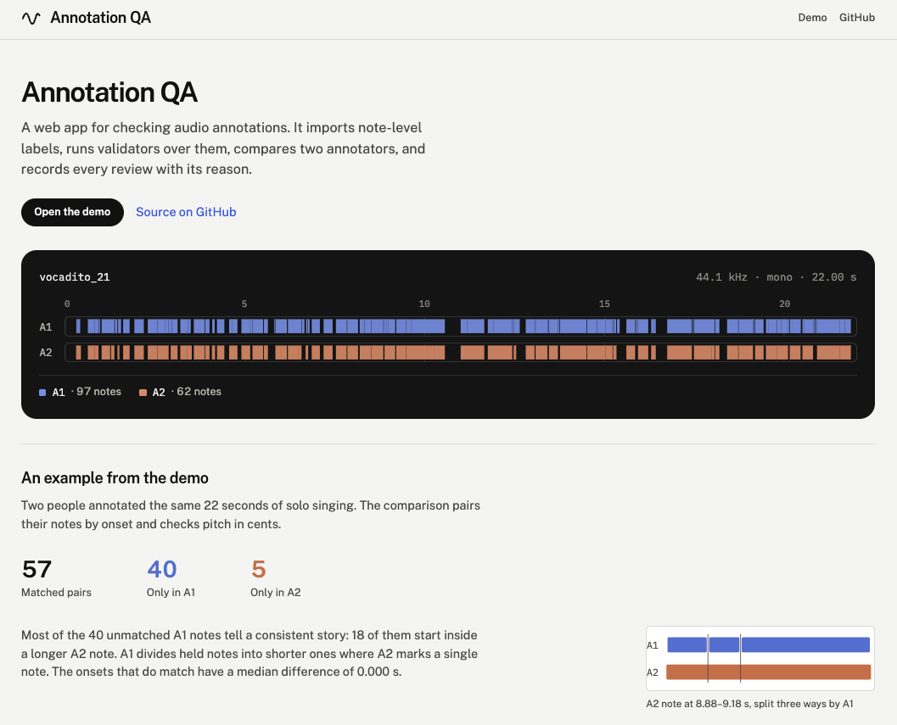

# Annotation QA

**A web app for validating, comparing, and reviewing research audio annotations.**

Django · Django REST Framework · PostgreSQL · Vue 3 · Docker Compose



## Overview

Research audio annotations are often stored as CSV files without systematic validation,
version tracking, or review history. This project provides a quality assurance workflow
for annotations created in tools such as Tony and Sonic Visualiser.

- **Validate:** Import annotations with provenance and version history. Run pluggable
  checks for overlaps, ordering, coverage, and metadata inconsistencies.
- **Compare:** Align independent annotations and report pitch and timing differences
  separately, without treating either annotator as ground truth.
- **Review & export:** Track findings and corrections without overwriting original data,
  and export sessions to Sonic Visualiser.

## Demo

The demo data is five excerpts from the [vocadito](demo-data/vocadito/ATTRIBUTION.md)
singing dataset, each with note annotations from two annotators.

In `vocadito_21`, A1 marked 97 notes and A2 marked 62, with 57 matched pairs. Of A1's 40
unmatched notes, 18 begin inside an A2 note, consistent with A1 splitting notes that A2
keeps whole. Among matched note pairs, the median absolute onset difference is 0.000 s
across the five excerpts, while the annotations also differ in note segmentation and pitch
assignment for moving notes. Reporting pitch and timing separately helps distinguish these sources of
disagreement.

Comparison methods and design decisions are documented in the [design notes](docs/DESIGN.md).

## Quickstart

Requires Docker.

```bash
cp .env.example .env
docker compose up -d
docker compose exec django python manage.py migrate
docker compose exec django python manage.py createsuperuser
docker compose exec django python manage.py import_vocadito \
  --slug vocadito-demo --name "vocadito (demo subset)" --root /data/vocadito --validate
```

Open http://localhost:5173. Signed-out visitors get a read-only view; sign in at
http://localhost:8000/admin/ with the superuser account to run validators, compare
layers, and record reviews.

Run the tests with:

```bash
docker compose exec django python manage.py test annotations
```

The test suite uses synthetic fixtures, plus integration tests against the included demo
corpus.

## Status

Runs locally under Docker Compose; not yet deployed. Any signed-in user can upload, validate, compare and
review, and there are no role-based permissions yet. See [docs/DESIGN.md](docs/DESIGN.md)
for architecture, validation rules, comparison methods, configuration, and known
limitations.

## License

[MIT](LICENSE). Demo data: [vocadito (CC BY 4.0)](demo-data/vocadito/ATTRIBUTION.md).
